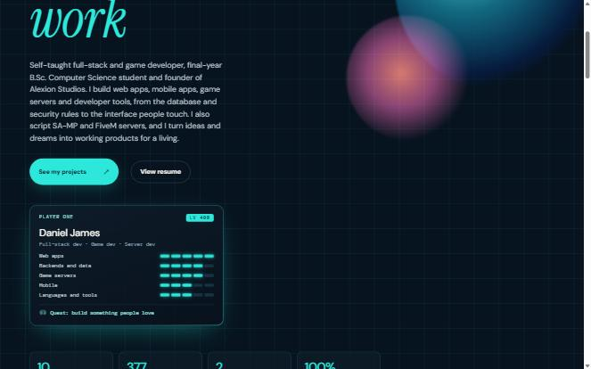
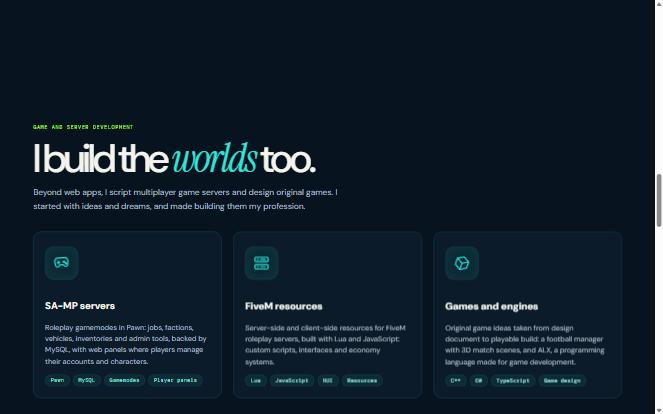

# Alexion Studios portfolio

Personal portfolio and resume of the founder of Alexion Studios. React and Vite, with hash routes so it works on any static host.

- **Home**: a game-style player card, selected work, a game and server development section (SA-MP and FiveM), toolbox, process and live numbers from the GitHub API.
- **Projects**: every project with a case study page (`#/projects/<slug>`).
- **Resume**: a one-page resume. Use "Download as PDF" and choose "Save as PDF".

## Screenshots





## Change the content

Everything lives in `src/data.js`: profile, skills, projects, experience and education. Edit it and the portfolio and the resume both update.

## Run it

```bash
npm install
npm run dev
npm run build
```

Pushes to `main` deploy automatically on Vercel. The company planning notes live in `src/Docs`.
